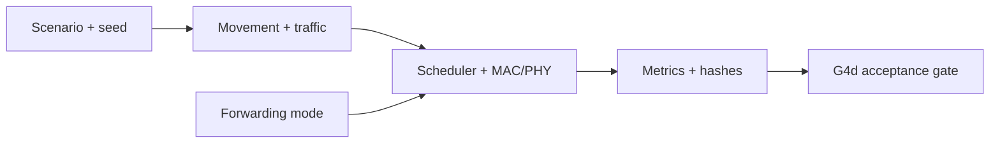

# BLE ADV-Inspired Forwarding Simulator

> A Python simulator for evaluating forwarding reliability and transmission costs under controlled network conditions.

Wireless devices can pass packets through neighboring devices to reach a destination. Sending more copies may improve delivery, but it can also increase network traffic. This project investigates the trade-off of that particular case, by using a simulator inspired by Bluetooth Low Energy (BLE) advertising.

The simulator compares **flooding**, where each eligible node relays a newly
received packet, with **controlled retransmission**, where a forwarding node
sends additional copies according to the configured policy. It models node
movement, packet traffic, and competition for radio access to compare their
outcomes.

The original **G4a–G4d experimental series** forms part of the broader
**DRF-BLE** research project. This repository contains its Python implementation,
scenario definitions, and all the results. None of the nine G4d scenarios passed the
combined acceptance criteria, so the result is reported as **`NULL/NEGATIVE`**.

## Problem & Users

I use these experiments to ask whether controlled retransmission can maintain
packet delivery while reducing transmission attempts compared with flooding.
Since delivery improvements can come with substantial extra traffic, this can be very usefull. Moreover, delivery alone is an incomplete measure of forwarding efficiency.

The main reliability measure is **packet-delivery ratio (PDR)**: the number
of packets delivered divided by the number injected into the simulation.
Transmission attempts provide a separate count of communication cost.

The project is intended for students with basic Python knowledge and
researchers studying reproducible network experiments. Its scenarios represent
controlled simulation conditions rather than measured emergency deployments.

## Features / Solution

| Experimental stage | Purpose |
|---|---|
| G4a | Implement the flood forwarding mode. |
| G4b | Implement the controlled-retransmission mode. |
| G4c | Compare complete runs of the two modes under matched initial conditions. |
| G4d | Apply a predefined acceptance gate to the paired results. |

The experiment covers **nine scenarios with ten seeds each**: an easy test
case and eight controlled stress scenarios. A seed controls the simulator's
random choices. **Paired seeds** mean both forwarding modes use the same
configuration and seed label, with matching movement, traffic, and initial
radio-clock drift (simulated differences in node clock rates). Their later
execution can diverge as forwarding decisions change.

The **G4d acceptance gate** is a predefined decision rule requiring delivery
safety, fewer transmission attempts, and an **oracle-gap score** to pass in
the same scenario. The oracle-gap score measures how often controlled
retransmission would be chosen for using fewer attempts without exceeding the
allowed delivery loss, if both modes' final outcomes were already known. It
is an optimistic evaluation signal, not an implemented node-level selector.

The gate uses **95% confidence intervals**, which summarize statistical
uncertainty across the paired runs. The exact criteria and results are in
the [G4d report](docs/g4d_oracle_gap_report.md).

## Architecture

The simulator combines a **medium access control (MAC)** abstraction, which
controls transmission opportunities, with a **physical layer (PHY)** model
that estimates signal and reception conditions.



| Component | Role in the simulation |
|---|---|
| [Configuration](src/config.py) | Defines node, traffic, radio, and timing parameters. |
| [Random streams](src/seeds.py) | Supplies repeatable random choices to simulation components. |
| [Mobility](src/mobility.py) and [traffic](src/traffic.py) | Generate node movement and packet injections. |
| [Event scheduler](src/scheduler.py) | Processes simulation events in time order. |
| [MAC engine](src/mac_engine.py) and [PHY model](src/phy.py) | Model channel access, signal conditions, and packet reception. |
| [Forwarding experts](src/experts/) | Decide which packets to relay or retransmit. |
| [Paired comparison](src/counterfactual/mode_comparison.py) and [G4d analysis](src/counterfactual/g4d_oracle_gap.py) | Collect mode outcomes, calculate confidence intervals, and evaluate the gate. |

Hashes identify configurations and result files so repeated runs can be
checked for consistency. The command scripts call the original implementation
without changing its algorithms, seeds, or statistical thresholds.

## Prerequisites

- **Windows on AMD64 with PowerShell** for the documented commands.
- **Python 3.14.4, 64-bit**, the version used in the verification runs.
- Git to clone the repository, and access to Python packages for installation.
- NumPy, pandas, SciPy, PyArrow, and pytest, installed through the requirements
  files below.

No BLE radio is needed to run the simulation. Other operating systems and
Python versions have not been verified so far. SciPy is required to reproduce the
recorded confidence-interval calculations.

## Installation

Clone the repository and enter its root directory:

```powershell
git clone https://github.com/MdSajid007/g4-forwarding-simulation.git
cd g4-forwarding-simulation
```

Create a virtual environment and install the pinned dependencies:

```powershell
python --version
python -m venv .venv
.\.venv\Scripts\python.exe -m pip install -r requirements-lock.txt
.\.venv\Scripts\python.exe -m pip check
```

`requirements.txt` lists the direct dependencies. `requirements-lock.txt`
contains the complete dependency versions used for verification. These
commands use the virtual environment's Python directly, so activation is
optional.

## Quick Start / Usage

Run all commands from the repository root.

**Smoke test:** run the easy scenario in memory to check the installation.

```powershell
.\.venv\Scripts\python.exe -B scripts\smoke.py
```

**Result and file verification:** check the saved results, configuration
bindings, summaries, report, and file hashes without rerunning the experiments.

```powershell
.\.venv\Scripts\python.exe -B scripts\verify_results.py
.\.venv\Scripts\python.exe -B scripts\verify_integrity.py
```

**Focused tests:** check the simulator components and G4 implementation.

```powershell
.\.venv\Scripts\python.exe -B -m pytest tests -p no:cacheprovider -q
```

**Full G4d reproduction:** run nine scenarios with ten paired seeds and two
forwarding modes, for **180 simulation-arm executions**.

```powershell
.\.venv\Scripts\python.exe -B scripts\reproduce_g4d.py
```

The command writes new files to the Git-ignored `reproduction/latest/` folder
and compares them with the original CSVs and report. It returns a nonzero
status if they differ. To keep another run separately:

```powershell
.\.venv\Scripts\python.exe -B scripts\reproduce_g4d.py --output-dir reproduction/repeat
```

Use this script rather than running `src.counterfactual.g4d_oracle_gap`
directly, because the original module command overwrites the reference files.

Verification on **2026-10-11** recorded **267 tests passed and 1 skipped**.
Two fresh Windows/Python 3.14.4 environments reproduced both G4d CSVs
byte-for-byte and the report text. The skipped test concerns fading, which is
disabled in the easy scenario. The environments shared one host.
See [reproducibility details](docs/REPRODUCIBILITY.md) for the full scope.

## Example Output

The smoke test produces:

```json
{"delivered": 48, "pdr": 1.0, "tx_attempts": 144}
```

This means 48 packets were delivered with 144 transmission attempts. Complete
delivery in this easy scenario does not establish performance under stress.

Result verification produces:

```json
{"g5_authorized": false, "paired_rows": 90, "scenarios": 9, "verdict": "NULL/NEGATIVE", "verified": true}
```

None of the nine scenarios passed all three G4d conditions. The
`g5_authorized: false` field indicates that the gate did not justify the next
selector-development stage. **`NULL/NEGATIVE` applies to the tested modes,
scenarios, seeds, and thresholds; it does not prove that adaptive forwarding
is universally ineffective.**

The [experimental report](docs/g4d_oracle_gap_report.md) and
[scenario summary](outputs/g4d_oracle_gap_summary.csv) show the delivery and
transmission-cost trade-offs for each scenario.

## Data / Model

This study contains simulation data and **no trained machine-learning model**.

| File | Contents |
|---|---|
| [Paired results](outputs/g4d_mode_comparison_results.csv) | 90 records with scenario, seed, configuration hash, mode outcomes, and pairing checks. |
| [Scenario summary](outputs/g4d_oracle_gap_summary.csv) | Nine summaries with means, confidence intervals, and gate decisions. |
| [Scenario definitions](experiments/scenario_configs/phase5_scenarios.py) | Eight controlled stress scenarios; the easy scenario is defined in `src/config.py`. |
| [Source provenance](PROVENANCE.json) | Original file identities and source-origin records. |

Delivery and relative-transmission differences use paired-sample t intervals.
Oracle-gap scores use Clopper-Pearson binomial intervals. G4d requires at
least ten paired seeds, valid pairing, a delivery-delta lower bound of at
least `-0.02`, a relative-transmission-delta upper bound of at most `-0.05`,
and an oracle-gap lower bound greater than `0.05` in one scenario.

These are comparisons of complete simulation runs, not interventions on a
single relay decision. Artificial fixtures in the tests check software
behavior and are separate from the experimental results.

## Limitations

- **MAC/PHY abstraction:** propagation, scanning, interference, and channel
  access are simplified. Carrier sensing and backoff do not constitute a
  validated BLE advertising controller or Bluetooth Mesh implementation.
- **Retransmission timing:** intervals and jitter are stored as intended
  timing metadata. The engine does not dispatch the policy's delayed timer
  hooks, so delayed retransmission scheduling is not implemented.
- **Energy units:** `tx_attempts` is a count-based cost proxy. The `energy_j`
  field multiplies seconds by milliwatts without converting to joules.
  It is not measured device energy and does not demonstrate battery savings.
- **Emergency traffic:** the emergency scenario uses competing application
  flows without distinct packet-priority forwarding.
- **Statistical scope:** the gate result is limited to the defined experiment.
  Initialization is paired, but later MAC/PHY behavior can differ between modes.
- **Generalization:** there is no physical BLE testing, field-deployment
  validation, standards-compliance evidence, or successful ML-controlled
  forwarding result.
- **Reproducibility:** only the documented Windows/Python environment was
  verified. Other library versions can change results; missing SciPy can
  trigger alternative interval calculations.

## Contributing · License · Contact

### Contributing

Please report issues with the command, Python environment, scenario, seed,
and observed output. Contributions should pass the focused tests, retain
existing attribution and [source provenance](PROVENANCE.json), and keep the
original results intact. Changes to policies, scenarios, or thresholds should
be documented as separate experiments.

### License

This project is shared for academic, educational, and research transparency purposes.

No open-source license has been assigned. Reuse, modification, or redistribution may require permission from the relevant copyright holders.

For details, see [Ownership and Licensing Status](LICENSE_STATUS.md).

### Contact

**Md Sajid Islam** - repository maintainer and project contact.

Department of Artificial Intelligence and Big Data,
Woosong University, South Korea.

- GitHub: [MdSajid007](https://github.com/MdSajid007)
- Email: [mister.sajidislam@gmail.com](mailto:mister.sajidislam@gmail.com)
