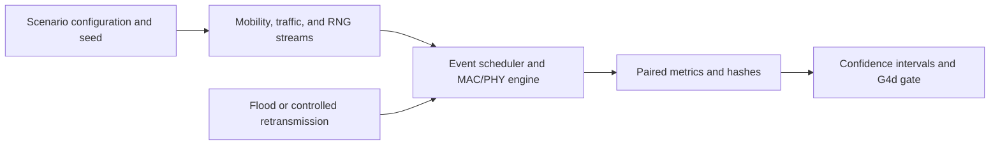

# G4 Forwarding Simulation

> Compare two forwarding modes under controlled network stress using deterministic seeds, transparent metrics, and a preserved negative result.

This project is a focused subset of the DRF-BLE research project. It
compares flooding with controlled retransmission in a **BLE ADV-inspired
simulator**, then checks whether the evidence justifies developing a selector.
The recorded verdict for this project is **`NULL/NEGATIVE`**: no tested scenario passes all
three required confidence-interval conditions. This is a simulation study;
Bluetooth Mesh compliance, hardware validation, and successful ML forwarding
are not established.

Prepared for Technical Writing README assignment.
No open-source license has been assigned; see [license status](LICENSE_STATUS.md).

## Problem & Users

A forwarding method can increase packet delivery while also increasing
network traffic. Comparing delivery alone can therefore hide its cost.
This project measures delivery and transmission attempts together before
investing in an adaptive selector.

The intended users are students learning simulation and technical reporting,
and researchers inspecting a small, reproducible forwarding comparison.
The scenarios are controlled experiments, and are not measured for emergency deployments.

## Features / Solution

- Two complete forwarding modes: `FloodExpertStateMachine` and
  `ControlledRetransmissionExpert`.
- Nine fixed scenarios, including an easy fixture and eight controlled stress
  scenarios, each evaluated with seeds 1-10.
- Matched mobility, traffic, and MAC drift initialization between the two arms.
- Packet-delivery ratios, transmission counts, configuration hashes, and
  confidence intervals in readable CSV files.
- A frozen gate that requires delivery safety, transmission reduction, and
  oracle-gap evidence in the **same scenario**.
- Focused tests, a quick smoke command, and a replay command that preserves
  the checked-in reference results.

The supported workflow covers G4a-G4d. Later selectors, trained models,
ns-3 experiments, and evidence-tooling research are outside this checkout.

## Architecture



`src/config.py` defines the configuration dataclasses. `src/seeds.py` provides
named random streams. Mobility and traffic builders create the shared initial
conditions. `src/mac_engine.py` runs the scheduled events and calls the policy
interfaces. `src/counterfactual/mode_comparison.py` compares complete mode
runs, and `g4d_oracle_gap.py` summarizes them and applies the statistical gate.

```text
src/                         Preserved simulator and G4 implementation
experiments/scenario_configs/ Preserved eight-scenario definitions
tests/                       Focused original regression tests
scripts/                     Smoke, verification, and safe replay commands
outputs/                     Two frozen historical G4d CSV tables
docs/                        G4d report, scope, and reproducibility record
PROVENANCE.json              Hashes of files copied from the original project
FILE_MANIFEST.json           SHA-256 inventory of the proposed release files
```

The copied source is unchanged. Small wrapper scripts provide convenient
commands without changing policies, seeds, scenario parameters, or gate
thresholds. See [scope and preservation](docs/SCOPE.md).

## Prerequisites

- **Python 3.14.4, 64-bit**, is the environment used for this candidate's checks.
- Windows with PowerShell for the commands below.
- Internet access to install the pinned Python dependencies.
- NumPy, pandas, SciPy, PyArrow, and pytest, supplied through the requirements
  files. SciPy is needed to retain the recorded confidence-interval method.

The workflow runs in software and requires no BLE radio. Other Python versions
and operating systems have not been validated for this release candidate.

## Installation

Clone this repository, then open PowerShell in its root directory:

```powershell
git clone https://github.com/MdSajid007/g4-forwarding-simulation.git
cd g4-forwarding-simulation
```

Create an isolated environment and install the complete dependency lock:

```powershell
python --version
python -m venv .venv
.\.venv\Scripts\python.exe -m pip install -r requirements-lock.txt
.\.venv\Scripts\python.exe -m pip check
```

These commands use the environment's Python directly, so activation is
optional. `requirements.txt` lists the direct dependencies;
`requirements-lock.txt` records the complete environment used for verification.

## Quick Start / Usage

Run the existing easy fixture in memory:

```powershell
.\.venv\Scripts\python.exe -B scripts\smoke.py
```

Verify the preserved CSV results, their configuration bindings, the summary,
and the report without rerunning simulations:

```powershell
.\.venv\Scripts\python.exe -B scripts\verify_results.py
.\.venv\Scripts\python.exe -B scripts\verify_integrity.py
```

Run the focused test suite:

```powershell
.\.venv\Scripts\python.exe -B -m pytest tests -p no:cacheprovider -q
```

Replay all nine scenarios with ten seeds and two forwarding modes:

```powershell
.\.venv\Scripts\python.exe -B scripts\reproduce_g4d.py
```

The replay performs 180 arm executions and writes into
`reproduction/latest/`, which Git ignores. It compares the generated files
with the preserved results and returns a nonzero status if they differ.
The checked-in CSVs and report are preserved. To keep a separate repeat:

```powershell
.\.venv\Scripts\python.exe -B scripts\reproduce_g4d.py --output-dir reproduction/repeat
```

Avoid invoking the original `src.counterfactual.g4d_oracle_gap` module directly
when preserving reference files: its historical command overwrites them.
Detailed validation scope and results are in the
[reproducibility record](docs/REPRODUCIBILITY.md).

Verification on 2026-10-11: **267 tests passed and 1 was skipped**. Two fresh
Windows/Python 3.14.4 environments reproduced both G4d CSVs byte-for-byte and
the report text. The skip concerns fading disabled in the easy fixture.

## Example Output

The easy-fixture smoke command produces:

```json
{"delivered": 48, "pdr": 1.0, "tx_attempts": 144}
```

Here `pdr` is the packet-delivery ratio. This small fixture's complete delivery
does not establish performance under the stress scenarios.

The frozen-result verification reports:

```json
{"g5_authorized": false, "paired_rows": 90, "scenarios": 9, "verdict": "NULL/NEGATIVE", "verified": true}
```

For example, `p5_partition_reconnect` has mean PDR `0.5528304` for flood and
`0.5886792` for controlled retransmission. The controlled mode's mean relative
transmission-attempt change is approximately `+1.4133`: its delivery increase
comes with substantially more attempts, so it does not pass the combined gate.
See the [full G4d report](docs/g4d_oracle_gap_report.md) and
[scenario summary](outputs/g4d_oracle_gap_summary.csv).

## Data / Model

This checkout contains simulation results and **no trained model**.

| File | Contents |
|---|---|
| `outputs/g4d_mode_comparison_results.csv` | 90 paired records: scenario, seed, configuration hash, mode outcomes, cost proxies, and initialization-pairing checks |
| `outputs/g4d_oracle_gap_summary.csv` | Nine scenario summaries: means, confidence intervals, and gate conditions |
| `experiments/scenario_configs/phase5_scenarios.py` | Eight controlled scenario builders; the easy fixture is defined in `src/config.py` |
| `PROVENANCE.json` | Byte-identity records for the preserved source and historical results |

The evaluation uses paired-sample t intervals for delivery and relative
transmission deltas, and Clopper-Pearson binomial intervals for oracle-gap
scores. A positive gate requires at least ten paired seeds, valid pairing,
delivery-delta lower bound >= `-0.02`, relative-transmission-delta upper bound
<= `-0.05`, and oracle-gap lower bound > `0.05` in one scenario. Point estimates
or favorable conditions from different scenarios cannot be combined to pass.

The experiment compares whole runs. It does not measure the causal effect
of forcing one relay decision, train a selector, or demonstrate that the
oracle information is available to a deployed node. Artificial test fixtures
check software behavior and are separate from the stored experiment data.

## Limitations

- **Simulation scope:** channel, propagation, scanning, and traffic behavior
  are abstractions. The MAC uses carrier sensing and backoff; it is not a
  validated BLE legacy-advertising controller or Bluetooth Mesh stack.
- **Retransmission timing:** intended intervals and jitter are recorded as
  metadata. The engine lacks policy-owned delayed timer hooks, so these values
  do not implement delayed retransmission scheduling.
- **Cost measurement:** `tx_attempts` is a count proxy. The source's `energy_j`
  field multiplies seconds by milliwatts without conversion to joules; it is
  an uncalibrated proxy, not hardware energy or battery-life evidence.
- **Emergency naming:** the emergency scenario creates competing application
  flows; it does not encode distinct packet-priority forwarding.
- **Statistical scope:** the negative gate result concerns these modes,
  scenarios, seeds, and thresholds. It does not prove that adaptive forwarding
  or machine learning can never help.
- **Pairing scope:** initialization is matched; MAC/PHY execution need not
  remain identical after the forwarding modes diverge.
- **Transfer:** no BLE hardware measurements, field deployment, compliance
  test, or successful ML-based forwarding result is established.
- **Reproducibility:** verification is scoped to the recorded environment.
  Different library versions can change numerical results. Missing SciPy can
  trigger alternative interval calculations in the preserved source.
- **Release rights:** publication was authorized by the account holder.
  Copyright ownership and third-party rights have not been independently
  verified, and no open-source license is assigned.

## Contributing · License · Contact

**Contributing:** use Issues to report a
problem with the command, environment, scenario, seed, and observed output.
Proposed changes should preserve the frozen reference results, pass the
focused tests, and distinguish software verification from performance claims.
Changes to policies, thresholds, or scenarios require a separately identified
experiment rather than replacing this study's negative result.

**License:** this repository has no assigned open-source license. The account
holder authorized publication, but that authorization does not establish
independent copyright clearance or grant an open-source license. Read
[ownership and licensing status](LICENSE_STATUS.md).

**Contact:** use the [repository's Issues tab](https://github.com/MdSajid007/g4-forwarding-simulation/issues).
No personal email address or unverified source-author identity is included.
